# Time-Aware Research Agent — detailed architecture

> **Status:** implemented local-first application and architecture record. The Node/TypeScript chat UI/API, bounded research and citations, durable history/recall, continuation, and synthetic local evaluation are implemented. The permitted Phase 10 model fallback and paid Phase 12 quality/cost gates remain open; see the checked plan for exact status. The 100-client load run is synthetic, not hosted capacity. Cloud deployment, production identity, hosting selection, and multi-replica operation are deferred.
>
> **Decision:** Node/TypeScript + Hono + LangGraph + LangChain + LangSmith. All chat, embedding, and reranking inference initially runs on AWS Bedrock through a local LiteLLM gateway (a remote gateway remains an optional future connection mode). The application uses OpenAI-compatible chat/embedding clients; reranking has a separate gateway contract.
>
> This is the detailed engineering document. [DESIGN.md](DESIGN.md) is the concise, one-page summary of implemented behavior, local measurements, tradeoffs, and future work.

## Contents

1. [Requirements and invariants](#1-requirements-and-invariants)
2. [System architecture](#2-system-architecture)
3. [Technology decisions and ownership](#3-technology-decisions-and-ownership)
4. [Module boundaries](#4-module-boundaries)
5. [Domain language and common contracts](#5-domain-language-and-common-contracts)
6. [HTTP, SSE, and browser behavior](#6-http-sse-and-browser-behavior)
7. [Admission, ordering, and execution](#7-admission-ordering-and-execution)
8. [LangGraph workflow](#8-langgraph-workflow)
9. [LiteLLM and Bedrock inference](#9-litellm-and-bedrock-inference)
10. [Temporal history and architecture C](#10-temporal-history-and-architecture-c)
11. [Embedding and indexing pipeline](#11-embedding-and-indexing-pipeline)
12. [Hybrid retrieval and reranking](#12-hybrid-retrieval-and-reranking)
13. [Context budgeting and large histories](#13-context-budgeting-and-large-histories)
14. [Web-search evidence](#14-web-search-evidence)
15. [Answer construction and validation](#15-answer-construction-and-validation)
16. [Database design](#16-database-design)
17. [Transactions, jobs, and recovery](#17-transactions-jobs-and-recovery)
18. [Caching and performance](#18-caching-and-performance)
19. [Observability and evaluation](#19-observability-and-evaluation)
20. [Security, privacy, and deletion](#20-security-privacy-and-deletion)
21. [Deployment and configuration](#21-deployment-and-configuration)
22. [Testing and acceptance gates](#22-testing-and-acceptance-gates)
23. [Repository structure and delivery sequence](#23-repository-structure-and-delivery-sequence)
24. [Alternatives, risks, and unresolved decisions](#24-alternatives-risks-and-unresolved-decisions)
25. [Documentation references](#25-documentation-references)

## 1. Requirements and invariants

The source of assignment requirements is [problem_statement.md](problem_statement.md).

### 1.1 Hard requirements

- Application implementation is JavaScript or TypeScript on Node. FastAPI is not the application backend.
- The completed application must start with `npm install` followed by `npm run dev`. This remains an implementation acceptance requirement, not a claim that a chat app already exists. Live inference additionally requires a running configured gateway and documented service credentials.
- Exactly one **model-visible tool**, `web_search`. Historical retrieval, persistence, embedding, and reranking are application operations, not extra tools exposed to the agent.
- Every required API key is documented in `.env.example`; no credentials are committed.
- Public repository and one-page `DESIGN.md` are submission deliverables. Publishing is a separate action from writing this document.
- Initial infrastructure is local: run the installed LiteLLM executable using the Node helper and existing AWS CLI profile credentials. LiteLLM is a third-party inference service, not a custom Python application backend. No cloud resources are provisioned. A future reviewer may instead use a provided remote gateway, avoiding local Python/AWS setup.

### 1.2 Product behavior

The differentiating question is: **what did we discuss, what was supported then, and what can we verify now?**

| User question | Required behavior |
| --- | --- |
| “On Monday we shortlisted five CRM tools. Has anything changed?” | Recover the correct original shortlist; compare relevant historical and current evidence |
| “What did I ask on 3 November?” | Retrieve original questions for the interpreted local date; do not approximate with vector top-k |
| “Is your answer still correct?” | Identify the referenced answer, separate its claims, verify mutable claims, and correct mistakes explicitly |
| “What about those five?” | Resolve references through continuity and history or clarify competing interpretations |

### 1.3 Invariants

1. Every private read is scoped to an authenticated owner, including vector searches, snapshots, SSE streams, and citations. Automatic historical reads also enforce recall eligibility; exclusion cannot be bypassed through derived indexes.
2. Originals establish what was said. Extracted claims, embeddings, summaries, and reranker scores are derived aids.
3. Retrieved source evidence establishes observations; attaching a citation does not prove semantic support.
4. “No relevant update found” is different from “unchanged.” Missing historical support is different from proof of an earlier error.
5. A turn uses fixed `now`, timezone, and historical visibility cutoff. Later messages cannot silently enter its baseline.
6. Query and document vectors must belong to the same compatible embedding space and index generation.
7. Every model invocation fits an explicit input/output budget, including tool schemas and tool results.
8. A retry cannot create a second logical user turn or publish duplicate final answers.
9. Telemetry outages do not fail user turns. Sampled traces are not the durable answer audit record.
10. User deletion and permission changes override snapshot reuse and cache reuse.

### 1.4 Initial non-goals

No cloud deployment/provisioning, production authentication rollout, managed database provisioning, autonomous watches, notifications, unrestricted browsing, arbitrary code tools, multi-region writes, custom inference server, or multi-agent research team. Large comparisons may fan out into bounded graph tasks without introducing autonomous agents.

### 1.5 Confirmed grilling decisions

The following policies were accepted together. Deployment inputs were explicitly deferred; the separate acceptance of question 20 preserves a test target only.

| Question | Accepted policy |
| --- | --- |
| 1 — Significant updates | Judge significance against stated user needs: pricing, relevant capabilities, breaking changes, deprecations and material availability; explain relevance |
| 2 — User-reported baseline | Permit explicitly attributed user-provided prices/quotes; do not promote them to externally verified public prices |
| 3 — Corrections | Preserve original messages; append corrections and use the corrected object for subsequent references while exact historical recall returns originals |
| 4 — Conflicting sources | Compare dates and plan/billing details; show unresolved conflicts instead of inventing a definitive change |
| 5 — Price evidence | Require source passages containing relevant price/comparison dimensions; fetch through search if snippets are insufficient, otherwise qualify/abstain |
| 6 — Timezone | Initialize from browser, allow editing, display interpreted dates when relevant; visibly fall back to UTC, never IP-only inference |
| 7 — Missing year | Prefer the most recent past date consistent with context, state it, clarify material competing interpretations |
| 8 — Freshness | Fresh search or validation for explicit current verification; only reuse within a declared short freshness policy with original observation time |
| 9 — Large exact recall | Paginate original questions chronologically with count/continuation; summary is optional, not a substitute |
| 10 — Deadline | Configurable 60-second starting deadline; verified partial result plus named gaps and explicit continuation as a linked new run |
| 11 — Streaming | Progress immediately; research answer content after validation; ordinary chat can stream directly |
| 12 — New input during work | Wait or explicitly stop-and-send; no implicit queue of references to an unseen answer |
| 13 — Spend | Enforce call/query/token limits; small bounded live checks before setting measured dollar limits; separate indexing budget; no total experiment budget supplied yet |
| 14 — Recall exclusion | Ordinary conversations eligible by default; explicit exclusion prevents subsequent automatic retrieval through every derived representation |
| 15 — Retention | Keep original conversations and bounded supporting excerpts until deletion initially; operational logs have a shorter configurable retention |
| 16 — Trace content | Full synthetic evaluation traces permitted; real-user metadata/redacted content by default for LangSmith and gateway logs |
| 17–19 — Deployment inputs | Deferred: no hosting/auth-provider decision or cloud deployment needed for this phase; use existing local AWS configuration for tests |
| 20 — Load target | 100 connected clients and 10 active research turns, with background indexing, is a local test workload, not provisioned capacity |
| 21 — Release blockers | Leakage, duplicate publication, incompatible vectors, silently omitted subjects, fabricated citations and broken recovery block release; numeric quality/cost/latency gates follow baseline measurement |

Cross-conversation historical recall and explicit reconstruction of missing historical evidence were accepted earlier. See [CONTEXT.md](CONTEXT.md) for the domain terminology. Local inference checks validate transport/model access only; they are not research-quality or concurrency benchmarks.

## 2. System architecture

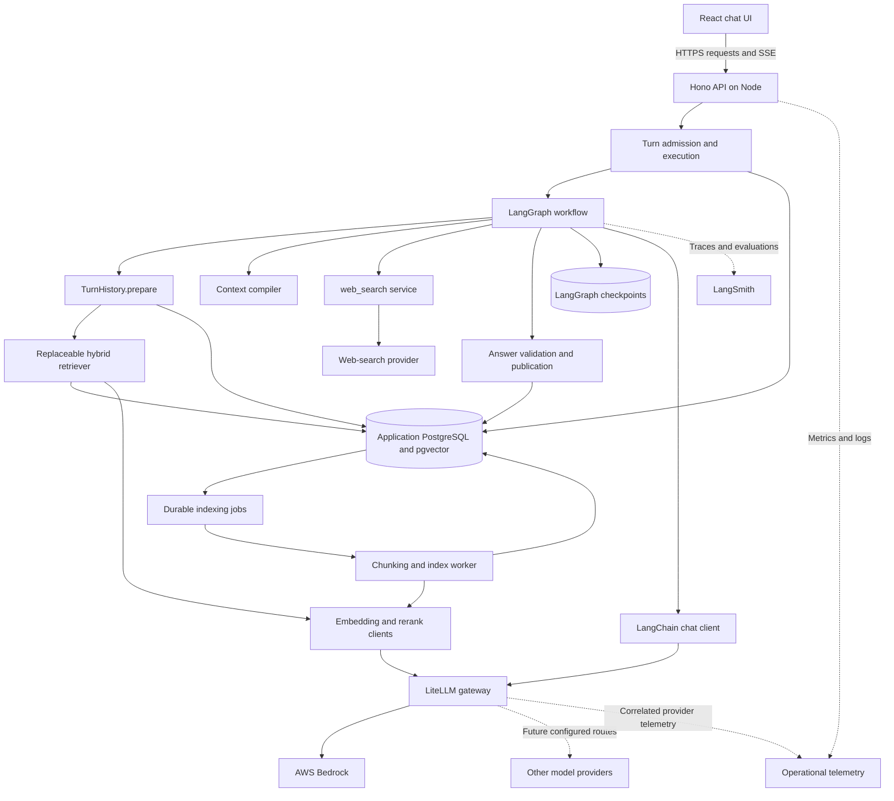

The Node application is a modular monolith. Local development hosts the API, graph executor, and background job loop together. Production may run the same codebase as separate API and worker processes. LiteLLM initially runs as a separate local process, not an additional custom application backend. Production process splits described below are future guidance, not initial implementation requirements.

The application database and checkpoint database may share one production PostgreSQL server, but their tables, migrations, and responsibilities are distinct. A shared server does not make separately committed operations atomic.

### 2.1 Three forms of persistence

| Persistence | Owner | Meaning |
| --- | --- | --- |
| Original messages, source observations, claim versions | Application | Durable historical record under the retention policy |
| Historical context snapshot | `TurnHistory` | Exact historical material and interpretations selected for a run |
| Graph checkpoint | LangGraph checkpointer | Execution state needed to resume a graph |

A graph checkpoint must not become a second unbounded transcript archive. A context snapshot must not be treated as a permanent authorization grant.

## 3. Technology decisions and ownership

| Area | Selected baseline | Rationale / qualification |
| --- | --- | --- |
| Runtime | Node 24 LTS; strict TypeScript; npm lockfile | Node requirement; pin supported versions during implementation |
| API | Hono and Node adapter | Small transport layer; application owns run and reconnect semantics |
| UI | React + Vite | Chat, evidence links, history and status states; built assets served by Node in production |
| Validation | Zod | Validate configuration, external input, tools, gateway responses, structured outputs |
| Workflow | LangGraph JS `StateGraph` | Checkpointing, branching, execution state and streaming [D1] |
| Inference client | LangChain `ChatOpenAI` and `OpenAIEmbeddings` configured for LiteLLM | Reuse compatible clients; package name does not imply OpenAI hosts inference [D2] |
| Inference gateway | Local LiteLLM executable, pinned tested version; optional future container | Bedrock translation, credentials, deployment routing and bounded retries [D3] |
| Initial backend | AWS Bedrock for all model roles | Model access and regional availability verified with small local inference calls |
| Agent telemetry | LangSmith | Trace inspection, datasets and experiments [D4] |
| Operations | OpenTelemetry + Pino structured logs | HTTP/database/gateway timing, resource metrics and correlated errors |
| Local application data | File-backed PGlite, required extensions loaded | Simple startup with PostgreSQL-oriented schema; verify extension support in pinned version [D5] |
| Production application data | Managed PostgreSQL + pgvector | Transactional history, full-text and vector retrieval together [D6] |
| SQL/migrations | Drizzle + explicit parameterized SQL | Typed schema; review retrieval and concurrency SQL directly |
| Checkpoints | Packaged SQLite saver locally; PostgreSQL saver in production | Avoid implementing a custom PGlite checkpointer [D7] |
| Dates | chrono-node plus explicit calendar/timezone policy | Parser output is a candidate interpretation, not product policy |
| Search | Tavily first, behind a provider interface | Evaluate search quality and freshness; optional fallback after evidence |
| Reranking | LiteLLM rerank endpoint backed by Bedrock | Separate contract; rerank is not an OpenAI embeddings operation [D8] |
| Tests | Vitest, Playwright, k6 | Boundary behavior, browser flow, controlled load |

### 3.1 Use packages without surrendering domain rules

- LangGraph owns graph execution machinery. Application code defines graph nodes, run authorization, publication, and budgets.
- LangChain owns model message/tool integration. Application code defines what historical evidence belongs in context.
- LiteLLM owns provider translation. Application code knows the permitted model capability envelope and embedding-space identity.
- pgvector owns similarity search. Application code enforces ownership, temporal semantics, and coverage reporting.
- LangSmith observes behavior. Application data retains the audit trail even if tracing is sampled or unavailable.

Do not build a second generic model SDK, generic workflow engine, vector database, or logging framework.

## 4. Module boundaries

Organize around complete behavior, with infrastructure behind each module. Internal helper files are implementation details, not mandatory public APIs.

| Module | Owns | Public boundary | Explicitly does not own |
| --- | --- | --- | --- |
| API and identity | Authentication, request validation, HTTP errors, SSE transport | HTTP routes | Retrieval decisions or model prompts |
| Turn execution | Admission, idempotency, ordering, leases, cancellation, finalization fence | `TurnService` | LangGraph's internal scheduler |
| Historical context | Time/reference interpretation, authoritative hydration, ambiguity, snapshots | `TurnHistory.prepare` | Web freshness or final answer truth |
| Retrieval | Candidate discovery, fusion, conditional rerank, coverage | `HistoryRetriever.retrieve` | Authorization grants or assertion truth |
| Ingestion/indexing | Source-linked chunks, embeddings, claims extraction, index watermarks | Durable typed jobs | Synchronous answer completion |
| Context compiler | Model-aware token accounting, selection, compaction, coverage | `ContextCompiler.compile` | Deleting the original archive |
| Research graph | Search decisions, bounded iterations, structured answer draft | `ResearchGraph` | Unbounded planning or hidden tools |
| Search evidence | Queries, provider calls, freshness, cache, provenance | `SearchService.search` | Historical private-memory retrieval |
| Answer publication | Structural/evidence rules, partial coverage, citations, durable final answer | `AnswerPublisher` | Claiming code proves semantic entailment |
| Inference configuration | Role bindings, capability registry, gateway clients | Configured LangChain models + embeddings; `Reranker` | Bedrock-specific request translation |
| Observability/evaluations | Trace correlation, redaction, quality datasets | Instrumentation and eval harness | User-visible business state |

Dependency direction: transport -> application modules -> repositories/gateway/search ports. Retrieval internals do not import API request contexts. Domain policy does not depend on Hono or provider-specific payloads.

## 5. Domain language and common contracts

The TypeScript below specifies application contracts, not exact SDK constructor signatures. Brand IDs in implementation where helpful. Validate wire representations with Zod. Serialize large sequence numbers as decimal strings to avoid JavaScript precision loss.

```ts
type Id = string;
type Instant = string; // UTC ISO-8601

type Principal = {
  userId: Id;
  authSessionId: Id;
};

type AuthorizedTurn = {
  userId: Id;
  conversationId: Id;
  turnId: Id;
  runId: Id;
  userMessageId: Id;
  now: Instant;
  timezone: string; // IANA zone, fixed for this run
  historyCutoff: string; // committed owner sequence BEFORE current input
  authorizationEpoch: number;
};

type RunBudget = {
  deadline: Instant;
  maxModelCalls: number;
  maxSearchQueries: number;
  maxResearchRounds: number;
  maxInputTokensPerCall: number;
  maxOutputTokensPerCall: number;
  maxEstimatedCostUsd: number;
};

type SourceSpan = {
  messageId: Id;
  startUtf16: number;
  endUtf16: number;
  contentHash: string;
};

type OriginalMessage = {
  id: Id;
  conversationId: Id;
  role: "user" | "assistant";
  content: string;
  recordedAt: Instant;
  ownerSequence: string;
};

type Coverage = {
  scope: "conversation" | "user_history";
  searchedWindows: Array<{ start: Instant; endExclusive: Instant }>;
  returned: number;
  truncated: boolean;
  indexLagMessages: number;
  degradedBranches: Array<"semantic" | "lexical" | "rerank">;
  retentionGap: boolean;
  nextCursor?: string;
};
```

Use half-open time windows `[start, endExclusive)`. Source offsets are explicitly UTF-16 for JavaScript strings; keep the original content hash so normalization cannot silently invalidate offsets.

### 5.1 Error taxonomy

| Class | Example | Handling |
| --- | --- | --- |
| Input | Invalid timezone or oversized message | HTTP 400/413; no run |
| Authorization | Wrong owner or expired session | HTTP 401/403/404 according to disclosure policy |
| Conflict | Another turn active, idempotency payload mismatch | HTTP 409; do not duplicate |
| Capacity | Admission budget exhausted | HTTP 429 with retry guidance |
| Dependency | Gateway/search/database outage | Typed failure; retry or degraded result within budget |
| Coverage | Truncated retrieval, index unavailable | Explicit incomplete coverage, not missing history |
| Semantic ambiguity | Two plausible shortlists | Clarification result, not infrastructure failure |
| Context overflow | Required evidence cannot fit | Recompile once, decompose, or return partial/clarify |

Do not expose raw provider errors or credentials to the browser. Preserve a safe error code and correlation ID.

## 6. HTTP, SSE, and browser behavior

### 6.1 Proposed routes

| Method and path | Purpose | Important contract |
| --- | --- | --- |
| `POST /api/conversations` | Create conversation | Authenticated ownership |
| `GET /api/conversations` | Paginated history list | Owner-scoped cursor |
| `GET /api/conversations/:id/messages` | Original messages | Owner checked; stable pagination |
| `POST /api/conversations/:id/turns` | Admit input | `Idempotency-Key`; returns turn/run IDs |
| `GET /api/runs/:id` | Current/final run state | Reconnect fallback |
| `GET /api/runs/:id/events` | SSE subscription | Owner checked; `Last-Event-ID` replay |
| `POST /api/runs/:id/cancel` | Explicit cancellation | Idempotent state transition |
| `GET /api/evidence/:id` | Evidence excerpt and provenance | Ownership/retention policy applies |
| `DELETE /api/conversations/:id` | Delete conversation | Immediately revoke access; enqueue cleanup |
| `GET /health/live` | Process health | Does not require every provider healthy |
| `GET /health/ready` | Serve/admit safely | Database/configuration available; bounded checks |

Admission returns `202 Accepted`; replay of an existing request returns the existing identifiers/status. A request-hash mismatch for the same idempotency key returns 409. The browser submits a turn, then subscribes to its run. Meaningful events are persisted so completion before subscription is safe.

### 6.2 Event contract

```ts
type RunEvent = {
  schemaVersion: 1;
  eventId: string; // monotonically increasing within a run
  runId: Id;
  timestamp: Instant;
  type:
    | "started" | "status" | "answer_delta"
    | "clarification" | "completed" | "failed" | "cancelled";
  payload: Record<string, unknown>; // discriminated Zod schema per type
};
```

- Progress events describe actions, not unverifiable findings: “Checking current pricing,” not “No changes” before verification.
- Research answer text is emitted only after its structured draft passes publication checks.
- Final persisted answer is canonical. Token/delta events are presentation artifacts and can be coalesced; do not store one database row per token.
- Replay durable status/final events. If deltas are not retained, reconnect returns the canonical final answer rather than promising byte-perfect token replay.
- Use heartbeat comments, no proxy buffering, bounded subscriber buffers, and server/client idle handling.
- A disconnected subscriber does not cancel an admitted run. Explicit cancellation does.
- On replay-window expiry, send a resync instruction and load `/api/runs/:id`.

### 6.3 User experience

Show status, cancellability, partial/incomplete coverage, historical message links, source URLs, and “checked as of” time. Distinguish “could not search” from “searched and found no matching update.” Allow citations to historical messages without labeling them external verification. Avoid exposing internal model/provider names in normal conversation UI unless useful to a user.

## 7. Admission, ordering, and execution

### 7.1 Admission sequence

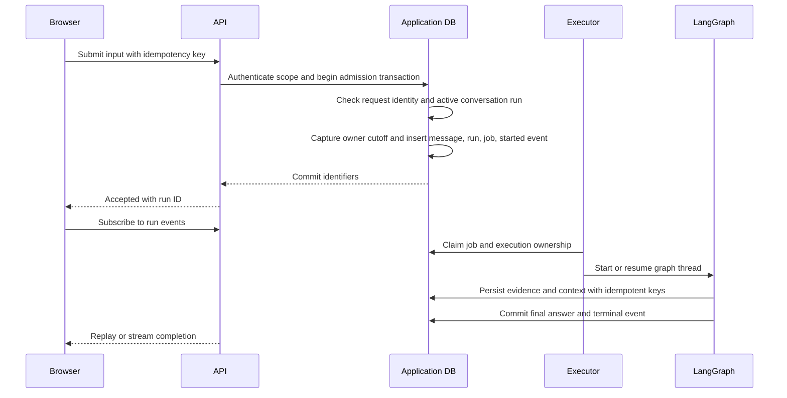

### 7.2 Committed historical visibility

Use a per-user `user_clocks` row with a transactional `committed_sequence`. Every authoritative history write for that owner locks this row briefly and increments its value in the same transaction as the write. Rollback also rolls back the counter update. This gives a committed visibility boundary across conversations; a standalone database sequence does not guarantee commit order.

Admission reads the previous sequence under this lock as `historyCutoff`, then assigns the current user message the next value. The current input is supplied separately and is not retrieved as historical evidence. Assistant publication and source observations use the same protocol. Serialize writes briefly per user, not network calls. This is suitable for a personal chat workload; very high write concurrency per owner would require revisiting the ordering scheme.

Lock order is consistent: owner clock, then conversation, then run. Derived jobs do not advance original-history time; they reference source sequences. Claims created later cannot be presented as knowledge that existed at the cutoff merely because their source is old. Snapshot assembly distinguishes later interpretation of an old source from earlier stored evidence.

### 7.3 Per-conversation concurrency

Initial policy: one active run per conversation. Reject another input with a clear 409 while allowing explicit cancellation. Avoid an implicit queue whose later turns would have ambiguous reference times. Different conversations for the same user can run concurrently within the user/global quota.

The admission transaction creates a durable `execute_run` job. API execution is not tied to request lifetime. Workers poll durable jobs; optional notifications improve wakeup latency but are not the source of truth.

### 7.4 Run state

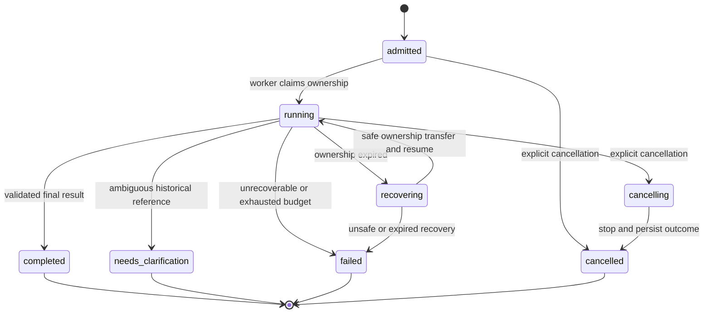

A clarification answer ends this run; the user's clarification starts a new turn. A retry/resume attempt is not a new logical turn. A user-requested fresh verification creates a new run with a new fixed `now`.

### 7.5 Ownership and graph concurrency

Run leases carry a monotonically increasing fencing token. All application side-effect/finalization writes require the current token and active status. Heartbeat before expiry; abort work on renewal failure.

Fencing only application writes is not enough to protect checkpoint writes by overlapping graph executors. Production therefore uses a PostgreSQL session advisory lock per graph thread for the duration of active execution, held on a dedicated connection, plus the lease for recovery/accounting. Losing that connection must abort the executor. Acquire the lock before resume and verify that the pinned checkpointer's writes cannot continue unfenced after lock loss; if that cannot be guaranteed, add a narrow fenced checkpointer wrapper or fail closed pending termination of the old executor. This is a required chaos-test gate, not a claimed automatic LangGraph feature.

The dedicated connection is a capacity cost; cap active runs and size the pool accordingly. Do not hold an SQL transaction open during inference. Local mode has one executor process. Gateways can still charge for an interrupted call; exactly-once inference billing is not promised.

## 8. LangGraph workflow

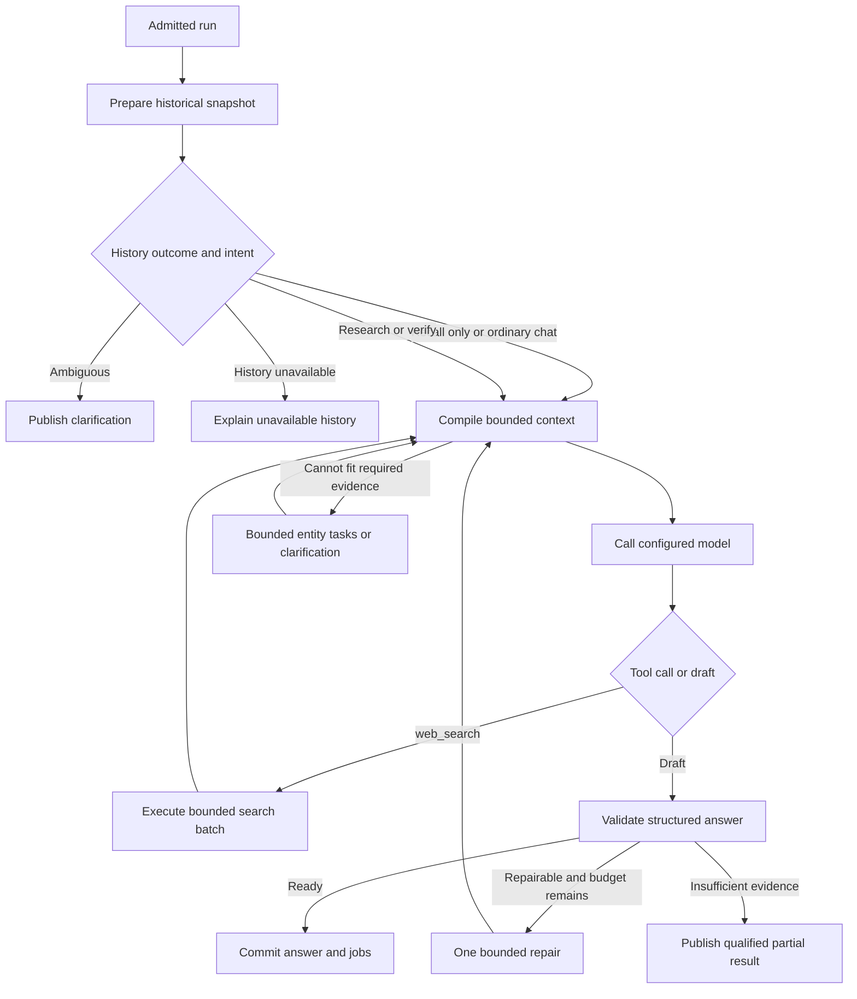

### 8.1 State design

Persist IDs, execution counters, prompt/configuration versions, bounded working messages, and structured draft state. Retrieve source bodies on demand from authorized repositories. Avoid continuously appending full tool outputs and transcript copies to checkpoint state.

```ts
type ResearchState = {
  runId: Id;
  turnId: Id;
  snapshotId?: Id;
  evidenceIds: Id[];
  route: "chat" | "recall" | "research" | "recall_verify";
  researchRound: number;
  modelCalls: number;
  searchQueries: number;
  contextManifestId?: Id;
  draftId?: Id;
  graphVersion: string;
  capabilityVersion: string;
};
```

Working messages are additional bounded graph state using LangChain message types; their serialization and reducer behavior follow the pinned LangGraph version. State above is the domain portion, not a complete SDK schema.

### 8.2 Routing

Deterministic signals handle obvious recall and conversation continuations. Use the fast model only when needed, with a strict output schema. Uncertainty about freshness selects research; uncertainty about which historical object is meant selects clarification, not speculative searches for guessed products. Resolve references before search fan-out.

No extra planner call for every turn. The research model proposes the one permitted tool. Enforce graph recursion limits **and** application counters/deadlines; neither replaces the other.

### 8.3 Recovery

Choose a graph thread per logical run rather than accumulating the whole conversation in one checkpoint thread. LangSmith conversation grouping remains `conversationId`. On resume, use the recorded graph and prompt versions. Persist operation IDs for side effects. A crash between a source write and checkpoint commit can repeat a node; unique operation keys make the write idempotent. Model calls may repeat when their result was not durably recorded.

Do not automatically re-run finalization if the application DB already marks the run terminal. Reconcile database status before graph resume. Graph migrations either support the recorded version or fail the run with an explicit restart path.

## 9. LiteLLM and Bedrock inference

### 9.1 Boundary

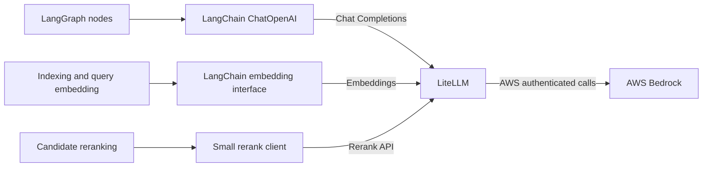

- Chat uses the gateway's OpenAI-compatible Chat Completions endpoint.
- Embeddings use its OpenAI-compatible embeddings endpoint.
- Reranking uses the separate Cohere-style rerank endpoint exposed by LiteLLM [D8]. Do not claim OpenAI standardizes this endpoint.
- The Node process does not contain Bedrock-native chat/embedding adapters and does not need AWS inference credentials.
- The gateway owns Bedrock request translation and authentication. Provider-native details are permitted only in gateway deployment configuration.
- Use LangChain's existing clients; keep only a thin configuration/capability layer and the small rerank HTTP adapter. OpenAI-compatible endpoints do not guarantee identical optional fields.

### 9.2 Logical roles and model choices

| Role | Application alias | Initial Bedrock target | Selection status |
| --- | --- | --- | --- |
| Main research | `chat-main-v1` | `us.amazon.nova-pro-v1:0` through LiteLLM | Local completion/tool-call/basic JSON-schema smoke checks passed; research quality still unevaluated |
| Fast work | `chat-fast-v1` | `us.amazon.nova-micro-v1:0` through LiteLLM | Local streaming smoke check passed; routing/extraction quality still unevaluated |
| History embedding | `history-embedding-v1` | Titan Text Embeddings V2, `amazon.titan-embed-text-v2:0`, 1024 float dimensions, normalization enabled | Concrete baseline; validate gateway translation and retrieval quality |
| Reranking | `history-rerank-v1` | Bedrock `cohere.rerank-v3-5:0` in `us-east-1` | Basic ranking smoke check passed through gateway; no direct Cohere service call |

Titan V2 supports the selected dimension/normalization options [D9]. This is an explicit baseline, not a claim that it wins multilingual or task-specific retrieval evaluations. Pin the resolved model and gateway configuration revision. The local routes above were invoked through the gateway in `us-east-1`; see [the verification report](docs/INFERENCE_VERIFICATION.md). Claude Sonnet 4.6 and Haiku 4.5 candidate routes failed with `INVALID_PAYMENT_INSTRUMENT` in the tested account. The Nova defaults are a verified development baseline, not a claim they are the best models for this task. No billing/subscription changes were made. Access can differ by profile, region and account. The `us.` profiles may route across their configured US regions.

All production model roles, including summary/extraction/repair calls, route to Bedrock initially. Alternative providers are enabled only through an intentional gateway configuration change and capability validation.

### 9.3 Capabilities and bindings

```ts
type ChatBinding = {
  alias: string;
  gatewayConfigRevision: string;
  compatibleDeployments: string[];
  contextWindowTokens: number; // minimum across automatic fallback group
  maxOutputTokens: number;
  supportsTools: boolean;
  structuredOutput: "native_schema" | "tool_schema";
  tokenizerId?: string;
  capabilityVersion: string;
};

type EmbeddingSpace = {
  id: string; // immutable generation identifier
  alias: string;
  resolvedModelId: string;
  dimensions: number;
  normalization: "unit" | "none";
  metric: "cosine";
  queryMode: string;
  documentMode: string;
  chunkerVersion: string;
  gatewayConfigRevision: string;
};
```

Maintain a reviewed capability manifest alongside gateway deployment configuration. The application uses logical roles; traces and index records retain actual resolved identities. Do not assume the gateway always reports model identity in a particular header: verify metadata capture with the pinned release, and correlate gateway request IDs with its deployment logs when necessary.

### 9.4 Embedding input modes

The application API distinguishes `embedQuery(text)` from `embedDocuments(texts)`. Titan's initial encoding configuration can be shared, but other models require query/document modes. If switching to such a model, configure separate query/document gateway aliases pinned to the same underlying model/space, or use a verified gateway extension through a thin embeddings wrapper. Do not silently omit required input modes to preserve a superficially uniform JSON body [D10].

Cache identity includes embedding space, role/input mode, content hash, and authorized namespace. Validate response order, count, dimensions, finite values and nonzero norms. Reject malformed vectors rather than indexing them as zeros.

### 9.5 Gateway policy

| Concern | Owner and policy |
| --- | --- |
| Provider authentication | Gateway workload IAM role; least-privilege model invocation permissions |
| Application authentication | Local single-user loopback exception uses an auto-generated master key because no gateway DB is configured; remote/production mode must use scoped keys, not the master key |
| Transient inference retries | LiteLLM, bounded per request; application model SDK retry disabled/minimal |
| Overall deadline and spend | Application, with gateway request timeout no greater than remaining budget |
| Chat fallback | Only capability-compatible deployments within configured context envelope |
| Smaller-context fallback | Return control to application to recompile; no silent undersized route |
| Embedding fallback | Same model/space only; never fallback to a different embedding model |
| Search retries | Search service, outside the inference gateway |
| Global inference quota | Local gateway request limits initially; shared coordination only when future replica deployment requires it |
| Content caches | Disabled initially for private chat; deliberate scoped policy required before enabling |
| Token/cost accounting | Log gateway/provider usage and versioned cost estimates; reconcile with billing separately |

Avoid retry multiplication between LangChain, LangGraph, HTTP libraries, and LiteLLM. A context-length error is a recompilation signal, not a transient retry. A stream that already emitted internal draft content cannot transparently splice a different model's continuation; restart the draft before publication.

### 9.6 Configuration shape

The executable local config is [infra/litellm/config.yaml](infra/litellm/config.yaml), started by [the Node helper](scripts/start-gateway.mjs). It uses existing AWS profile credentials and includes authentication/timeouts. The abridged model-routing shape below omits those operational settings; use the tracked config to run the gateway:

```yaml
model_list:
  - model_name: chat-main-v1
    litellm_params:
      model: os.environ/BEDROCK_MAIN_ROUTE
      aws_region_name: os.environ/AWS_REGION_NAME
  - model_name: chat-fast-v1
    litellm_params:
      model: os.environ/BEDROCK_FAST_ROUTE
      aws_region_name: os.environ/AWS_REGION_NAME
  - model_name: history-embedding-v1
    litellm_params:
      model: bedrock/amazon.titan-embed-text-v2:0
      aws_region_name: os.environ/AWS_REGION_NAME
  - model_name: history-rerank-v1
    litellm_params:
      model: os.environ/BEDROCK_RERANK_ROUTE
      aws_region_name: os.environ/AWS_REGION_NAME
```

Basic local HTTP compatibility was checked with LiteLLM 1.103.2. Further tests must validate full SDK integration, capability metadata, access controls, failure semantics and evaluated quality [D3]. Keep provider-integration settings out of user prompts.

## 10. Temporal history and architecture C

### 10.1 Stable public boundary

```ts
interface TurnHistory {
  prepare(turn: AuthorizedTurn, options: {
    signal?: AbortSignal;
    deadline: Instant;
  }): Promise<HistorySnapshot>;
}

type HistoricalAssertion = {
  id: Id;
  speaker: "user" | "assistant";
  source: SourceSpan;
  quote: string;
  normalized?: {
    entity: string;
    attribute: string;
    value: unknown;
    plan?: string;
    currency?: string;
    billingPeriod?: string;
    seats?: number;
  };
  attachedEvidenceIds: Id[];
  interpretationVersion?: string;
};

type HistorySnapshot = {
  id: Id;
  runId: Id;
  historyCutoff: string;
  authorizationEpoch: number;
  recentMessages: OriginalMessage[];
  recall:
    | { kind: "resolved"; messages: OriginalMessage[];
        assertions: HistoricalAssertion[]; coverage: Coverage }
    | { kind: "clarification_needed"; question: string; candidateMessageIds: Id[] }
    | { kind: "no_match"; coverage: Coverage }
    | { kind: "incomplete"; reason: "deadline" | "retrieval_failure" | "coverage_limit";
        coverage: Coverage }
    | { kind: "not_needed" };
  temporalInterpretation: TemporalInterpretation;
  retrieverVersion: string;
  configHash: string;
};

type TemporalInterpretation = {
  fixedNow: Instant;
  timezone: string;
  discussionWindow?: { start: Instant; endExclusive: Instant };
  comparisonWindow?: { start: Instant; endExclusive: Instant };
  assumptions: string[];
  ambiguous: boolean;
};
```

The snapshot is persisted as normalized references plus a versioned manifest and necessary excerpts. Do not return all stored records to the model automatically. The context compiler selects a bounded view.

### 10.2 What the module hides

It loads the current input from its admitted message, retrieves continuity, interprets dates, gathers candidate discussions, hydrates originals, resolves references, assembles source-linked assertions, and persists the result. The caller does not coordinate SQL, embeddings, or reranking.

A completed snapshot may be reused for the same run after access checks. A failed/incomplete preparation is retryable. Explicit re-evaluation records a new preparation version; a run records exactly which version it consumed. Deletion/access revocation invalidates reuse.

**Confirmed recall-scope policy:** when the current question references a prior discussion, automatically search the user's retained history across conversations as needed; an explicit request to search other conversations is not required. Prefer a clearly matching reference in the current conversation. This preference must not override an explicit date, subject, or reference pointing elsewhere. Ordinary unrelated questions do not trigger cross-conversation historical retrieval.

When another conversation supplies the reference, identify that source conversation in the answer using a readable date/title and an authorized link to the original exchange. If multiple discussions remain plausible and would materially change the answer, ask for clarification rather than treating the highest retrieval score as proof. The accepted terminology is recorded in [CONTEXT.md](CONTEXT.md).

### 10.3 Time semantics

| Expression or record | Policy |
| --- | --- |
| “Last Tuesday” in current input | Resolve using run `now` and user timezone; record the interpretation |
| “Tomorrow” in an old message | Interpret against that old message's timestamp |
| “3 November” without a year | Use supported context; clarify if materially ambiguous |
| “Changed since Monday” | Comparison interval; not automatically a hard message-date filter |
| Historical question listing | Calendar-day SQL window, with pagination and explicit completeness |
| Website publication date | Metadata, not proof of effective date |
| Retrieval timestamp | When observed, not when the world changed |

Initialize the user timezone from the browser, allow explicit edits, and visibly use UTC if it cannot be determined. Prefer the most recent past occurrence for a missing year only when consistent with context, and state that interpretation.

Build local-day boundaries using the IANA zone, including daylight-saving changes; do not add 24 hours blindly. Store timestamps in UTC and retain the interpretation timezone in each run/snapshot. A user's later timezone preference change does not rewrite an existing run.

### 10.4 Recorded time and effective time

Claim versions distinguish `recorded_at`/owner sequence from optional `valid_from` and `valid_to`. The valid interval expresses source-supported applicability, not a universal truth assertion. Unknown endpoints remain null. Append correction/supersession relationships rather than overwrite previous assertions. Store the time an interpretation was derived separately from the time of its original source.

Corrections are appended as source-linked records, not destructive edits. Subsequent reference resolution applies the latest applicable correction visible at the run cutoff; exact recall of an original message still returns that original. Distinguish a corrected shortlist from a historical price assertion: correction does not manufacture external support.

Example: on Friday the agent discovers an announcement published Thursday saying a price changed Wednesday. Friday is observation time, Thursday publication time, Wednesday supported effective time. If the announcement gives no effective date, the application must not invent Wednesday.

This is an application-level bitemporal design; PostgreSQL does not automatically reconstruct these semantics for us.

## 11. Embedding and indexing pipeline

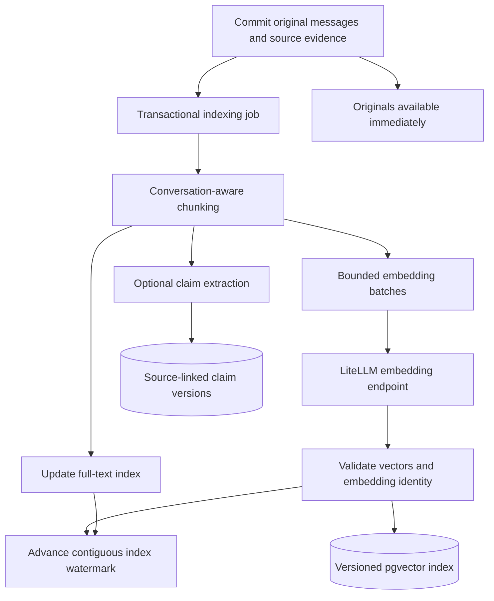

### 11.1 Retrieval units

Use a parent exchange or topic segment as the semantic unit. Prefer a user question plus its assistant answer, with role labels, over isolated short fragments. A completed list stays together where feasible. For very long exchanges, split into roughly 400–800-token children with about 50–100-token overlap as an initial experiment.

Each child records message spans and parent IDs. If metadata or role labels are added to embedding text, preserve a mapping to the untouched original content. Avoid summaries as the only indexed representation. Index summaries as supplementary navigation records clearly marked derived.

Incomplete exchanges are still retrievable as original messages. When an assistant reply arrives, create a new chunk version and supersede the earlier derived representation. The current run's input is excluded from historical candidates.

### 11.2 Job semantics

- Commit original content and indexing job in one application transaction.
- Deduplicate by owner, source range, chunker version, embedding generation, and operation type.
- Batch requests within gateway/provider input and RPM limits. An OpenAI-style batch request may translate into multiple Bedrock invocations; measure the underlying quota consumption.
- Persist completed chunks incrementally and retry failed items, not the entire successful batch.
- Advance the watermark only across contiguous successfully processed source ranges; retain a hole/error set for partial failures.
- Reconcile late results with deletion tombstones before insertion to prevent deleted content from reappearing.
- Index failure cannot block final answer publication or make original history disappear.

### 11.3 Vector storage

Initial space: 1024-dimensional float vectors, cosine distance, normalized Titan V2 output. Start with exact search for small owner-scoped datasets. Add HNSW only when measured query latency warrants it. PostgreSQL full-text search uses a GIN index; language configuration is deliberate, with a simple/token-preserving path for product names, IDs and mixed language.

Approximate vector search with metadata filters may under-return. Keep authorization predicates in SQL, measure recall, and evaluate iterative scans, oversampling, exact fallback, or partitioning [D6]. Never retrieve global private candidates into the application and then filter ownership in JavaScript.

### 11.4 Model migration

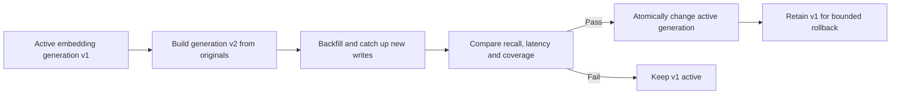

Changing model, dimensions, normalization, input-mode semantics, or chunking can require a new generation. Same dimension does not mean same semantic space. Each retrieval run pins a generation before encoding its query. During migration, dual-write or catch up through a committed watermark before switching. Old snapshots remain interpretable through original source IDs even after old vectors are retired.

For differing dimensions, use generation-specific vector tables/indexes or another tested storage layout; do not attempt a mixed-dimension HNSW index. Never silently repoint `history-embedding-v1` to a different model.

## 12. Hybrid retrieval and reranking

### 12.1 Internal contract

```ts
type RetrievalRequest = {
  turn: AuthorizedTurn;
  queryText: string;
  temporal: TemporalInterpretation;
  mode: "exact_date" | "explicit_reference" | "semantic_reference";
  embeddingSpaceId?: string;
  candidateLimit: number;
  deadline: Instant;
};

type Candidate = {
  parentId: Id;
  messageIds: Id[];
  matchedSpans: SourceSpan[];
  channels: Array<"recent" | "temporal" | "entity" | "lexical" | "vector">;
  channelRanks: Record<string, number>;
  fusedScore?: number;
  rerankScore?: number;
};

interface HistoryRetriever {
  retrieve(request: RetrievalRequest, options: {
    signal?: AbortSignal;
  }): Promise<{ candidates: Candidate[]; coverage: Coverage }>;
}

interface Reranker {
  rank(input: {
    query: string;
    documents: Array<{ id: Id; text: string }>;
    topN: number;
    deadline: Instant;
    signal?: AbortSignal;
  }): Promise<Array<{ id: Id; score: number }>>;
}
```

Implement the retriever as a replaceable module, not a public query language. Reuse LangChain document/retriever utilities where useful without requiring callers to assemble them.

### 12.2 Retrieval paths

| Path | Retrieval | Completeness semantics |
| --- | --- | --- |
| Explicit message/reference | Authorized original lookup | Exact if it exists and is visible |
| Questions on a date | Owner/time SQL, role filter, stable pagination | Can be exhaustive within retained scope |
| Vague historical reference | Prefer clear current-conversation references; search the user's other retained conversations as needed using recent + entity + lexical + vector candidates | Relevance search is bounded, never exhaustive proof of absence; materially competing discussions require clarification |
| Large date range | Paginated originals with response scope | Report remaining cursor or ask for narrowing |

### 12.3 Semantic path steps

1. Interpret the historical reference without inventing entities. Preserve multiple plausible windows when needed.
2. Establish hard filters: owner, access, deletion status, recall eligibility, committed cutoff; add discussion time only when justified.
3. Fetch recent continuity and original records not yet covered by indexing.
4. Retrieve lexical and semantic candidates, initially 30–50 per branch within latency budget.
5. Add explicit entity/temporal matches and preserve hard references as required candidates.
6. Fuse ranked lists with reciprocal-rank fusion: `score(d) = sum(weight_i / (k + rank_i(d)))`. Initial `k=60` is a tunable ranking constant, not a correctness rule.
7. Deduplicate child overlaps and collapse to parent exchanges while preserving matched source spans.
8. Rerank the top merged set, initially at most 40 parent candidates, through the Bedrock-backed gateway role. Include timestamp, speaker and concise source text.
9. Hydrate approximately 6–12 selected parents plus neighboring turns as a starting budget. Expand as necessary to recover a complete referenced object.
10. Resolve competing interpretations against originals. Reranker scores are not calibrated probabilities; use evaluated ambiguity rules and clarification.
11. Persist coverage, ranks, selected sources, interpreted dates, and versions in the context snapshot.

Hard date constraints and ownership are never relaxed by a reranker. Temporal relevance and current recency are different signals. Do not apply blanket recency decay to a query explicitly asking about last year.

### 12.4 Degraded behavior

Embedding failure: use temporal/lexical/recent candidates and mark semantic coverage degraded. Reranker failure: use fused ranking and mark rerank degradation. Full historical backend failure: return incomplete/unavailable, not no history. Permit one bounded expansion if a needed shortlist is only partially recovered; otherwise clarify or state the gap.

Historical and web candidate sets remain separate. Private history is never sent to the web-search provider merely to resolve references. Reranking private history does send selected content to the configured inference backend; its data policy is part of the application privacy boundary.

## 13. Context budgeting and large histories

### 13.1 Three tiers

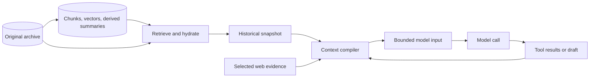

Stored history size is independent of prompt size. Large context windows are not a substitute for retrieval, evidence selection, or coverage accounting.

### 13.2 Compiler contract

```ts
interface ContextCompiler {
  compile(input: {
    turn: AuthorizedTurn;
    snapshotId: Id;
    evidenceIds: Id[];
    model: ChatBinding;
    outputReservation: number;
    workingInputCeiling: number;
    phase: "research" | "repair" | "synthesis";
    deadline: Instant;
  }): Promise<{
    manifestId: Id;
    messages: unknown[]; // LangChain BaseMessage[] in implementation
    estimatedInputTokens: number;
    method: "provider_count" | "model_tokenizer" | "conservative_estimate";
    omittedSourceIds: Id[];
    missingRequiredSubjects: string[];
    action: "invoke" | "decompose" | "clarify";
  }>;
}
```

The compiler runs before **every** invocation, including repair, summary, extraction and per-entity tasks. Every call gets its own input limit and remaining run budget.

### 13.3 Token equation

`inputBudget = min(workingInputCeiling, modelContextWindow - generatedTokenReservation - safetyMargin)`

The generated-token reservation includes visible output and any reasoning allowance according to the selected model's accounting; do not subtract the same reservation twice. Count instructions, current input, tool definitions, recent messages, source excerpts, prior tool results and provider framing.

Do not assume an OpenAI tokenizer is exact for Bedrock Claude/Titan merely because the wire format is OpenAI-compatible. Use verified model-aware counting or conservative estimates, record the method, and compare estimates with observed usage. Set a safety margin. Reject oversized incoming requests before expensive work when their irreducible input cannot fit.

Illustrative working input ceiling: 24k tokens, further capped by the actual model. Example allocation:

| Bucket | Starting target |
| --- | ---: |
| Instructions, schemas, current question | 3k |
| Recent continuity | 4k |
| Historical evidence | 7k |
| Current web evidence | 8k |
| Working notes / structured intermediate results | 2k |

Unused allocations can move between buckets. These are soft priorities beneath a hard total budget. Required evidence may displace optional continuity. Output reservation and safety margin are outside the 24k input allocation.

### 13.4 Compaction order

1. Deduplicate overlapping excerpts and repeated tool outputs.
2. Remove low-relevance optional candidates.
3. Select bounded verbatim passages with source IDs.
4. Summarize old conversational continuity from originals or source-linked summaries.
5. Replace large completed tool payloads with structured evidence references and concise observations.
6. Recount the serialized request, retaining valid tool-call/result pairing.
7. If necessary, decompose by entity or ask to narrow scope.

Preserve the current user question, system rules, selected historical reference, all required comparison subjects, and evidence needed for supported claims. Never silently drop the fifth product from a five-product question. Summaries do not authorize exact quotation or historical facts unsupported by original records.

Use LangChain trimming/summarization utilities where they fit [D11]. Agent middleware applies to compatible agent execution, not automatically to arbitrary custom graph nodes. Plain graph nodes invoke the compiler directly.

### 13.5 Oversized tasks

A large comparison can fan out into bounded per-entity graph tasks, each producing source-linked structured results. Synthesis receives their validated outputs and can rehydrate evidence if needed. Apply shared concurrency, token, query and cost limits; task decomposition does not reset budgets.

If the provider rejects context length despite estimation, permit one recompaction/recount attempt. Do not resend the same payload. A gateway fallback group must fit the minimum advertised context envelope; otherwise the application must choose and recompile for a different model.

## 14. Web-search evidence

### 14.1 Only model-visible tool

```ts
type SearchQuery = {
  q: string;
  domains?: string[];
  freshness: "current" | "historical" | "ordinary";
  publishedAfter?: Instant;
  publishedBefore?: Instant;
};

type EvidenceObservation = {
  id: Id;
  url: string;
  title: string;
  representation: "snippet" | "page_excerpt" | "page";
  text: string;
  contentHash: string;
  observedAt: Instant;
  publishedAt?: Instant;
  effectiveAt?: Instant;
  provider: string;
  queryId: Id;
  cacheHit: boolean;
};

interface SearchService {
  search(input: {
    queries: SearchQuery[];
    deadline: Instant;
    signal?: AbortSignal;
  }): Promise<{
    evidence: EvidenceObservation[];
    failures: Array<{ queryIndex: number; code: string }>;
    complete: boolean;
  }>;
}
```

The actual tool schema exposes only query intent and permitted filters. Runtime injects ownership, run IDs, deadline and remaining quotas. The model cannot expand its own budget or choose arbitrary network destinations outside policy.

### 14.2 Search policy

Prioritize official pricing pages, release notes, changelogs, and dated announcements. For “big updates,” assess materiality against the user's stated needs and explain relevance; do not repeat every release note or treat vendor marketing as significance. Retain source diversity when official evidence is missing or contradictory. Rank results for relevance; validate claims separately. Independent queries can fan out with bounded concurrency after the historical subjects are known.

Freshness filters usually concern publication/indexing metadata, not proof of real-world effective dates. “Current pricing” may require a recently observed undated official page. A search snippet is not a full page read. Price-change evidence must include the relevant price and comparison dimensions; when snippets omit them, fetch a supporting passage through the search service or qualify/abstain. Explicit current verification triggers fresh search/source validation unless the declared brief freshness policy permits reuse.

Store each source observation separately. An identical URL can produce different content at different times. A cache hit preserves the original `observedAt`. Do not manufacture freshness by recording cache-access time as observation time.

### 14.3 Optional content fetch

Initial implementation should use provider-supplied excerpts/raw content where available. If fetching top hits directly is necessary, it stays inside the one search tool and applies SSRF controls: allowed schemes, DNS/IP checks, private-network blocking, redirects revalidated, timeouts, response limits, content-type restrictions, and no credential forwarding. No arbitrary browser or code-execution capability is added.

Treat all retrieved text as untrusted data. Prompt boundaries, restricted tools, URL controls, and adversarial evaluations work together; a label saying “untrusted” is not a complete defense.

## 15. Answer construction and validation

### 15.1 Three-layer claim model

| Layer | Evidence | Example |
| --- | --- | --- |
| We said | Original assistant/user message | “We listed Starter at $20 per seat” |
| Evidence attached then | Historical source observation | “The stored pricing excerpt showed annual billing” |
| Evidence supports now | Current source observation | “Today's retrieved page lists this plan and billing basis” |

A previous answer can be wrong without the external world changing. A historical source can be missing without proving the answer was wrong. Preserve these distinctions in data and wording.

**Confirmed reconstruction policy:** the research stage may reconstruct a missing historical baseline using evidence discovered today, provided that evidence explicitly supports the relevant earlier period. Label the result as reconstructed from evidence found now; preserve the original answer and its missing citation. An undated current pricing page alone cannot establish a past price, and a publication date alone does not prove when a quoted price applied.

Record newly discovered historical support as a new evidence observation with its actual observation time and supported historical period. Attach it to the current run's comparison, not retroactively to the original answer or the completed historical snapshot. The historical snapshot still describes what was recorded before its cutoff; the current research can add evidence about earlier events. Mixed baselines distinguish support available then from support recovered now.

### 15.2 Draft contract

```ts
type Comparison = {
  subject: string;
  attribute: string;
  baselineAssertionIds: Id[];
  baselineOrigin: "stored_evidence" | "reconstructed" | "user_reported" | "mixed" | "unsupported";
  baselinePeriod?: { start?: Instant; endExclusive?: Instant };
  historicalEvidenceIds: Id[];
  currentEvidenceIds: Id[];
  outcome: "changed" | "unchanged" | "prior_answer_incorrect" | "insufficient_evidence";
  dimensions: {
    plan?: string;
    currency?: string;
    billingPeriod?: string;
    seats?: number;
    region?: string;
    taxBasis?: string;
  };
  explanation: string;
};

type AnswerDraft = {
  asOf: Instant;
  summary: string;
  comparisons: Comparison[];
  citations: Array<{ label: string; evidenceId: Id }>;
  unansweredSubjects: string[];
  limitations: string[];
};
```

### 15.3 Validation responsibilities

Code checks schema, reference existence, owner scope, baseline/current linkage, source representation, supported dimension compatibility, required-subject coverage and as-of time. It can reject an annual/monthly mismatch when those fields are explicit. It cannot prove arbitrary natural-language entailment.

The research model evaluates semantic support against excerpts. Use source-linked structured drafts and evaluation datasets. A bounded repair can fix missing references or wording, but structural success is not a claim of guaranteed factual accuracy.

| Condition | Publication behavior |
| --- | --- |
| Current price known; historical support absent | State current price and inability to establish change |
| User supplies an unverified quote | Compare explicitly with the user-reported quote; do not call it a verified public price |
| Official sources conflict after date/plan normalization | Show the conflict and qualify or withhold the definitive change claim |
| Newly found evidence explicitly establishes the historical state | Use it with reconstructed-baseline attribution; retain the original answer's provenance |
| Same comparable observed price | Say “the checked price matches,” not “nothing changed anywhere” |
| Source contradicts earlier statement for that same historical period | Explicitly correct prior answer |
| Different currency/plan/billing basis | Explain non-comparability; do not report a price change |
| Search unavailable | Preserve recall, say current verification failed |
| Some products unverified | Name them and publish explicit partial coverage |

At the research deadline, publish verified findings with named gaps. Offer explicit continuation as a linked new run with its own fixed time and budget; never silently reset the old run's deadline. The continuation reuses only authorized evidence and refreshes time-sensitive sources.

Persist validated structured output and its rendered text in one finalization transaction. Stream answer presentation from this committed result. This avoids publishing claims that validation later retracts. Plain non-research chat can stream directly, but its final text must still be persisted and interruption semantics documented.

## 16. Database design

### 16.1 Entity relationships

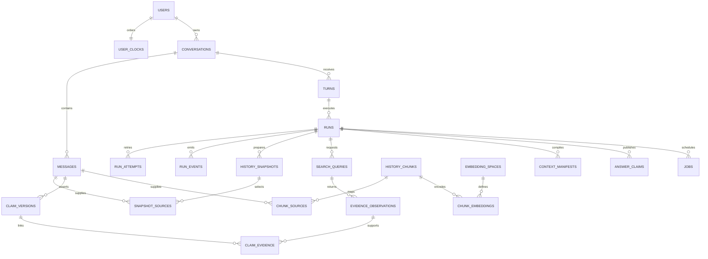

This diagram emphasizes relationships, not every physical column or framework table. Framework checkpoints and LiteLLM control-plane tables are owned by their packages and use separate schemas/databases.

### 16.2 Application tables

| Table | Key columns / constraints | Purpose |
| --- | --- | --- |
| `users` | `id`, identity subject, timezone, `authorization_epoch`, deleted status | Authenticated owner and access invalidation |
| `user_clocks` | `user_id` PK/FK, `committed_sequence` bigint | Transactional owner-wide history order |
| `conversations` | `id`, `user_id`, title, timestamps, deletion status, `recall_enabled`, recall-policy epoch | Conversation ownership |
| `messages` | `id`, owner/conversation, role, original content, recorded time, owner sequence, content hash | Original history; unique `(user_id, owner_sequence)` |
| `turns` | `id`, owner/conversation, user message, idempotency key/hash | Unique `(user_id, idempotency_key)` within documented retention window |
| `runs` | `id`, turn, status, fixed now/timezone, cutoff, budgets, active ownership, cancellation flag, result message ID | Logical run and publication guard |
| `run_attempts` | run, attempt number, fencing token, checkpoint lineage, graph/config versions, timing/error | Execution/recovery audit |
| `run_events` | run, monotonic sequence, type, versioned payload, timestamp | Reconnectable durable status/final events |
| `history_snapshots` | id, run, preparation version, cutoff, auth epoch, outcome, interpretation, coverage, config hash | Selected historical context |
| `snapshot_sources` | snapshot, message ID, source span/hash, required/optional | Provenance and exact source selection |
| `claim_versions` | id, source span, speaker, entity, attribute, normalized value/dimensions, recorded/derived time, valid interval, supersedes ID, correction source | Interpreted historical assertions |
| `claim_evidence` | claim ID, evidence ID, relation/assessment | Explicit claim-to-source association |
| `search_queries` | id, run, operation key, normalized query/filter hash, provider, timestamps, status | Search execution identity |
| `evidence_observations` | id, owner/run/query, URL, representation, text/hash, observed/published/effective times, source operation key | Immutable source observations under retention policy |
| `history_chunks` | id, owner, parent/exchange key, version, text/hash, source sequence range, `tsvector`, status | Searchable derived text |
| `chunk_sources` | chunk, message, span/hash | Chunk-to-original mapping |
| `embedding_spaces` | id, immutable model/dimension/mode/normalization config, generation status, watermark | Vector compatibility contract |
| `chunk_embeddings` | chunk ID, space ID, vector, status, created time | Unique `(chunk_id, space_id)`; dimension-specific physical layout |
| `memory_summaries` | source ranges, text/hash, summarizer version, coverage, validity status | Derived continuity/navigation aid |
| `context_manifests` | run/call ID, selected/omitted sources, token allocation, count method, prompt version | Actual model-input composition audit |
| `answer_claims` | run, subject, structured comparison, evidence links, validation outcome | Durable published reasoning artifacts, not hidden chain of thought |
| `jobs` | type, dedupe key, payload references, status, attempts, lease, available time | Indexing, extraction, cleanup and execution admission |
| `deletion_tasks` | owner/object scope, tombstone epoch, cleanup stages, status | Privacy lifecycle across derived stores |

Store large optional page bodies in object storage only when measured database growth warrants it; retain object hashes and ownership references. Initially bounded excerpts/text in PostgreSQL simplify consistency.

### 16.3 Constraints and indexes

- Composite foreign keys or equivalent constraints ensure child records reference parents under the same owner; an application-level UUID alone is not authorization.
- Partial unique constraint permits only one active run per conversation.
- Unique run/result linkage and operation keys prevent duplicate publication and source writes.
- `(user_id, recorded_at, id)` for date recall; `(user_id, conversation_id, owner_sequence)` for continuity/cutoff.
- `(user_id, normalized_entity, attribute)` for claims; index valid-time fields only for observed query patterns.
- GIN on chunk `tsvector`; pgvector cosine index per compatible embedding generation when needed.
- `(status, available_at)` and lease expiry indexes for jobs; `(run_id, sequence)` for events.
- Check constraints for interval ordering, nonnegative budgets, vector dimension compatibility and recognized states.
- Retention/pagination must not rely on a mutable title or offset-based scans over growing history.

### 16.4 Local versus production

Local application data uses file-backed PGlite; local graph checkpoints use the packaged SQLite saver. Both are bootstrapped by `npm run dev`. Test any native checkpoint dependency on supported reviewer platforms. No assumption that the PostgreSQL checkpointer works against a PGlite JavaScript object.

Production uses real PostgreSQL and the official PostgreSQL saver. PGlite cannot validate multi-connection locking, failover, connection pooling or all extension behavior. Run real-PostgreSQL contract/concurrency tests in CI. Local and production adapters satisfy behavioral contracts; switching drivers does not migrate existing files automatically.

## 17. Transactions, jobs, and recovery

| Boundary | Atomic application changes | What may happen separately |
| --- | --- | --- |
| Admit turn | Clock/cutoff, message, turn/run, execution job, started event | SSE delivery |
| Persist search observation | Query result and observation IDs under operation key | Graph checkpoint commit |
| Prepare history | Snapshot manifest and source links | Next graph checkpoint |
| Publish answer | Assistant message, structured claims, terminal run status/event, derived jobs | LangSmith export and final graph checkpoint |
| Request deletion | Tombstone/access epoch and cleanup jobs | Physical removal from checkpoints/indexes/telemetry |

### 17.1 Durable job handling

Claim ready jobs with transactional row locking in production. Use at-least-once execution, per-job dedupe keys, leases, capped exponential retry delays, and a terminal failed/dead-letter state. Do not retry malformed schemas indefinitely. Worker shutdown stops new claims, drains bounded work, and releases or expires leases safely.

Graph checkpoints recover a run's execution; jobs determine that it needs to be executed. The job system does not reproduce graph node orchestration. Derived tasks can be retried independently from the user-facing run.

### 17.2 Failure matrix

| Failure | Required behavior |
| --- | --- |
| API dies after admission commit | Existing run/job survives; idempotent client retry recovers IDs |
| Model completes before crash, result not saved | Call may repeat; record attempts/cost uncertainty |
| Source saved before checkpoint | Replay finds existing operation result instead of duplicate insert |
| Final answer committed before checkpoint | DB terminal status prevents republishing/resuming completed work |
| Executor ownership lost | Abort; prevent stale side effects and checkpoint corruption before transfer |
| Gateway unavailable | Bounded retry, then explicit failure/partial historical answer |
| Search partially unavailable | Keep successful evidence; state per-subject gaps |
| Embedding worker crashes | Originals remain searchable; retry missing derived work |
| Reranker fails | Use fused ranking and record degradation |
| SSE client disconnects | Run continues; reconnect or cancel explicitly |
| LangSmith unavailable | Bounded telemetry queue/drop policy; answer remains available |
| Database unavailable | Do not admit work or publish unverifiable success |

Cancellation is cooperative. Set cancellation status durably, abort active I/O where supported, stop new model/search work, and prevent later finalization. An upstream provider may finish and bill after cancellation; report cost as observed/estimated accordingly.

## 18. Caching and performance

### 18.1 Cache policy

| Cache | Key | Correctness rule |
| --- | --- | --- |
| Search | Authorized namespace, normalized query, all filters, provider/config version | Preserve observation time; current-verification policy can bypass |
| Embeddings | Owner namespace/content hash, space ID, query/document mode | Never reuse across spaces or incompatible modes |
| Snapshot | Run/preparation version, cutoff, authorization epoch | Recheck deletion/permissions before reuse |
| Source extraction | Content hash, parser/version, representation | Hash does not establish freshness |
| Prompt prefix | Provider-supported static prefix | Do not assume provider supports or honors caching identically |

Use in-process caches and single-flight initially. They are not globally coordinated across replicas. Add a supported distributed cache only when replica deployment requires it; durable truth remains in PostgreSQL. Do not cache private results under globally shared query strings.

### 18.2 Initial tunable budgets

| Parameter | Starting hypothesis |
| --- | ---: |
| End-to-end research deadline | 60 seconds |
| Main research rounds | 3 |
| Total foreground model calls, including repairs/decomposition | 8 |
| Search queries | 10 |
| Concurrent search requests | 3 |
| Retrieval candidates per lexical/vector branch | 40 |
| Reranker inputs | Up to 40 parents |
| Selected parent exchanges | Initially 8, expandable within budget |
| Working model-input ceiling | 24k tokens, subject to model envelope |
| Final output reservation | Initially 4k tokens, capability-dependent |
| Required-evidence recompaction retry | 1 |

Exact per-turn cost cap follows a small bounded local evaluation and current provider pricing; no total live-experiment budget has yet been specified; do not invent a dollar guarantee. Background indexing has a separate capped budget and cannot consume all foreground capacity.

First status under 100 ms is an aspirational server-side admission target under a defined load, not a network-wide guarantee. Measure first status, first answer content, and total duration separately. Avoid speculative web searches before reference resolution. Parallelize independent reads and search queries, not stages with data dependencies.

### 18.3 Scale path

1. Initial: one local API/executor process, loopback LiteLLM, PGlite and SQLite checkpoints.
2. Future only: managed PostgreSQL and a hosted gateway after an explicit deployment decision.
3. Separate worker process and API replicas; shared admission/provider quotas; tuned connection pools.
4. Add vector approximate indexing/partitioning after profiling and recall evaluation.
5. Move large evidence blobs to object storage and partition old event records if needed.
6. Consider a separate vector service or workflow deployment platform only when measurements identify a concrete limit.

For multi-replica gateway deployments, configure LiteLLM's required shared persistence/cache for the enabled budget, virtual-key, and rate-limit features. Do not assume per-process counters become globally accurate automatically.

## 19. Observability and evaluation

### 19.1 Trace hierarchy

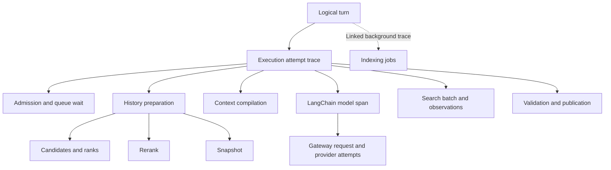

LangSmith is the agent trace/evaluation interface [D4]. OpenTelemetry and Pino cover operational infrastructure. Link application and gateway request IDs; validate propagation with a real integration test rather than assuming trace headers automatically cross providers. Avoid instrumenting the same model call twice as unrelated runs.

### 19.2 Required metadata

Record turn/run/attempt/conversation IDs, snapshot/context manifest IDs, graph/prompt/retriever/chunker versions, embedding generation, logical model alias, actual resolved deployment, gateway config revision, provider request IDs, deadlines, token usage, and cost-estimate version.

For retrieval, record branch counts, ranks before/after fusion/rerank, selected source IDs, coverage, index lag, hard/soft date constraints and clarification outcome. For context, record token allocation, counting method, omitted required subjects, compaction and decomposition. Do not store private model chain of thought.

### 19.3 Metrics

| Category | Metrics |
| --- | --- |
| User latency | Admission/status latency, first answer content, completion, queue wait |
| Dependencies | Database, gateway, provider/search latency; 429/timeout/error rates |
| Cost/capacity | Input/output tokens, embedding calls, rerank volume, cost estimates, active runs |
| Retrieval health | Index lag, failed chunks, empty/degraded branches, candidate recall in evals |
| Answer quality | Reference accuracy, supported claims, false-change reports, omitted subjects |
| Reliability | Retry counts, lease loss, checkpoint recovery, duplicate-write prevention |
| Context | Estimated versus reported tokens, compaction rate, overflow errors, partial coverage |

Use bounded metric labels such as route/model role/error code. High-cardinality run/user IDs belong in logs/traces. Sample successful traces as volume grows, preserve failures/quality investigations according to policy, and keep durable provenance independent of sampling.

### 19.4 Privacy and failure behavior

Redact credentials before instrumentation. Default exports use metadata and sanitized excerpts; enable full prompt/result capture only under an explicit content-retention policy. Telemetry exports are asynchronous, bounded, and allowed to fail without failing a turn. Gateway logs follow the same policy. Usage without complete provider billing data is labeled estimated.

## 20. Security, privacy, and deletion

- Future production only: managed identity/OIDC with server-side sessions or verified tokens. Initial local mode uses explicit development identity and retains owner-scoping in all repositories. Development identity is explicit and forbidden in production configuration.
- Secure cookies, same-origin API/SSE, CSRF/origin protection for cookie-authenticated mutations, request-size limits and schema validation.
- Server-created authorized scope; models cannot supply trusted owner IDs, SQL, checkpoint thread IDs or budget overrides.
- Parameterized SQL, ownership constraints, and optional defense-in-depth PostgreSQL row-level policies. RLS configuration is tested with connection pooling; it is not a substitute for repository scoping.
- Local loopback-only gateway uses a generated master key stored in an ignored mode-0600 file, without a gateway database. This single-user development exception must not be used remotely. Future deployed gateway keys are scoped to permitted aliases/budgets and admin access is isolated. AWS credentials remain in the existing CLI credential chain locally, or a workload role in future deployment.
- Model aliases are allowlisted. Client input cannot select arbitrary providers or endpoints.
- Search receives only necessary public search terms; private transcripts are not copied into web queries.
- Retrieved text is data. Tool allowlists, bounded execution, schema validation and injection tests support the prompt boundary.
- Escape/sanitize rendered Markdown and links; never execute raw HTML from model/source content.

### 20.1 Recall exclusion and retention

Retain originals and bounded supporting evidence until user deletion in the initial product. Configure a shorter operational-log retention; do not silently expire original history under the guise of log retention. Full trace content is permitted for synthetic evaluation fixtures; real-user traces remain metadata/redacted by default.

An explicit “exclude from future recall” control sets a conversation recall policy and bumps its epoch. Cross-conversation retrieval, chunks, vectors, summaries and new snapshots must obey it. Exclusion is not deletion: the user may still open that conversation and use its own visible context, but another conversation must not pull it in automatically. Historical snapshots remain audit records under the retention policy, yet cannot be reused as a route around the exclusion. Recheck policy during hydration/publication and invalidate affected pending context; delayed indexing must not reinstate eligibility. A future explicit override requires a separately defined user action, not an inferred model decision.

### 20.2 Deletion workflow

Immediately tombstone the conversation/user scope, bump authorization epoch, deny further reads, and cancel affected runs. Enqueue idempotent cleanup of originals, chunks, vectors, claims, summaries, snapshots, cached views, context manifests, graph checkpoints and relevant object-storage content. Recheck tombstones on every delayed index result and snapshot read.

Define backup retention and restore-time deletion replay. External trace deletion follows the selected provider's supported lifecycle and policy; do not promise instantaneous removal from all backups. Periodically reconcile cleanup failures. An immutable audit convention never overrides deletion requirements.

## 21. Deployment and configuration

### 21.1 Local startup — current scope

The local chat application starts with `npm install && npm run dev` when the documented inference gateway is available. The API and browser app start independently of provider readiness and report actionable readiness failures; current research requires configured search. See the [clean-start walkthrough](README.md), [gateway config](infra/litellm/config.yaml), [local instructions](infra/litellm/README.md), [launcher](scripts/start-gateway.mjs), and [inference verifier](scripts/verify-inference.mjs).

Run `node scripts/start-gateway.mjs` with an existing authorized AWS CLI profile selected in the environment or ignored `.env`. It binds LiteLLM to `127.0.0.1`, generates a local key in `.data/litellm.key`, and uses existing AWS credentials without copying them into the repository. In another terminal, `node scripts/verify-inference.mjs` performs bounded, billable checks on synthetic text. No hosting, managed database, IAM, model subscription or billing changes are made.

PGlite and SQLite checkpoint initialization belong to the upcoming application implementation. Local LiteLLM itself requires its third-party executable/dependencies, already present in this environment; see the README for setup elsewhere. This is separate from the Node backend requirement. A future remote gateway can remove this local prerequisite, but provisioning one is not part of the current work.

Without live-service credentials, the eventual UI should show an explicit setup state. Mock/fixture mode must never masquerade as live research. Do not claim a fully working chat application based on inference-only smoke tests.

### 21.2 Future production topology — deferred

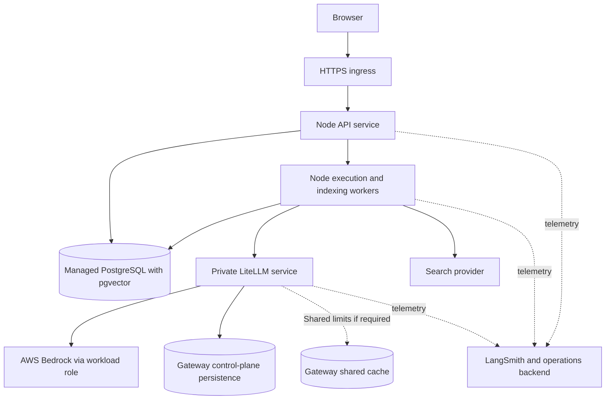

The API-to-worker arrow is logical dispatch through durable jobs, not an assumed direct RPC. Start with API and worker in one Node service if capacity permits. A concrete AWS deployment can use container services, managed PostgreSQL, secrets management and workload roles; exact hosting sizes remain unmeasured. Bedrock region and allowed inference profiles are deployment configuration.

The gateway's own database/cache requirements depend on enabled LiteLLM features. Keep its credentials/tables isolated from application data even if infrastructure is shared. Do not expose gateway administration to browsers.

### 21.3 Application environment contract

The tracked [.env.example](.env.example) covers the runnable local gateway helpers. The fuller application settings below remain a planned contract until the chat app exists:

```dotenv
NODE_ENV=development
PORT=3000
APP_ORIGIN=http://localhost:3000
AUTH_MODE=development
LOCAL_DATA_DIR=.data
DATABASE_MODE=pglite
# DATABASE_URL=postgresql://...
CHECKPOINT_MODE=sqlite
# CHECKPOINT_DATABASE_URL=postgresql://...

INFERENCE_BASE_URL=http://127.0.0.1:4000/v1
INFERENCE_API_KEY=
CHAT_MAIN_MODEL=chat-main-v1
CHAT_FAST_MODEL=chat-fast-v1
EMBEDDING_MODEL=history-embedding-v1
EMBEDDING_SPACE_ID=titan-v2-1024-v1
RERANK_URL=http://127.0.0.1:4000/rerank
RERANK_MODEL=history-rerank-v1
MODEL_CAPABILITIES_PATH=config/model-capabilities.json

TAVILY_API_KEY=
LANGSMITH_TRACING=false
LANGSMITH_API_KEY=
LANGSMITH_PROJECT=minmi-local
# OTEL_EXPORTER_OTLP_ENDPOINT=...
# OIDC_ISSUER=...
# OIDC_CLIENT_ID=...
# OIDC_CLIENT_SECRET=...
# SESSION_SECRET=...
```

Use separate documented gateway deployment variables for AWS region/model routes, workload identity, gateway master/admin secret, and optional gateway database/cache credentials. Remote/production application keys must not be gateway master keys; the explicit local single-user exception is documented above. If routing chat/embeddings to another OpenAI-compatible host, configure endpoint/key/model bindings and validate capabilities; configure reranking separately if that host does not support it.

### 21.4 Future deployment procedure — deferred

1. Pin Node, package lockfile, gateway image, model/capability manifest and schema versions.
2. Run CI and provider capability smoke tests in staging.
3. Apply backward-compatible application and framework migrations with a single migration actor.
4. Deploy compatible graph code; preserve support for in-flight graph versions or drain before breaking changes.
5. Verify readiness, one traced turn, checkpoint resume, citation visibility, and indexing catch-up.
6. Canary changed prompts/models/retrievers using evaluation evidence and controlled traffic.
7. Roll back code/config only if schema and graph state remain compatible; use forward migrations for irreversible schema changes.

Backups require a tested restore path. Define and measure RPO/RTO before claiming production service levels. Observe database pool saturation, memory, gateway availability and task backlog. The system is production-designed, not production-proven until these gates pass.

## 22. Testing and acceptance gates

### 22.1 Boundary tests

Use real local persistence for ordinary module tests and mocked external responses at provider boundaries. Test observable behavior through `TurnHistory`, admission/publication, search, and context compilation rather than reproducing implementation helpers in tests.

| Area | Required cases |
| --- | --- |
| Temporal interpretation | Browser timezone initialization/editing, visible UTC fallback, UTC/local midnight, DST, missing year with stated interpretation, quoted historical relative dates |
| Reference resolution | Competing shortlists, automatic cross-conversation recall on historical references, source-conversation attribution, no unrelated cross-conversation recall, explicit references overriding conversation preference, comparison interval versus discussion date |
| Recall | Exact originals with chronological pagination/counts, appended corrections, excluded/deleted history, retained-scope no-match |
| Indexing | Delayed embeddings, partial batches, malformed/zero vectors, duplicate jobs, deletion races |
| Vector migration | Wrong space rejected, dual-generation cutover, dimension change, rollback |
| Retrieval | Lexical-only fallback, rerank timeout, filtered ANN under-return, required-list completion |
| Evidence | Missing and user-reported baselines, reconstructed baseline with explicit historical support, current-only reconstruction rejected, original provenance preserved, source conflicts, significant-update relevance, prior mistake, annual/monthly mismatch, stale caches |
| Context | Huge tool result, huge user input, valid message pairing, smaller-context fallback, no omitted subject |
| Execution | Duplicate submission, crash windows, cancellation, lease loss, stale executor/checkpoint writes |
| Security | Cross-user IDs in all routes/retrievers, recall exclusion through derived indexes/snapshots, prompt injection, unsafe URLs, hostile Markdown |
| Streaming | Completion before subscription, reconnect, expired cursor, explicit cancel |

Real PostgreSQL tests cover commit-order cutoff, concurrent admission, locks, active-run uniqueness, row ownership, pgvector filters and checkpoint recovery. PGlite is not evidence for these production concurrency properties.

### 22.2 Evaluation datasets

Frozen clock, known original messages, known source spans, recorded search results, and pinned model configuration. Include thousands of distractor exchanges, repeated product names, overlapping dates, incorrect prior answers, multilingual/paraphrased references where relevant, incomplete indexes and contradictory web evidence.

Separate deterministic fixture tests from live model evaluations. Deterministic tests prove application behavior under given responses; model evaluations measure interpretation/answer quality. LangSmith datasets and experiments compare prompt, model, retriever, chunking and reranking revisions.

Metrics: candidate recall@k, selected-reference accuracy, full-subject coverage, supported-citation rate, false-change rate, correct abstention/clarification, latency and cost. Inspect failures manually; LLM judges alone are not ground truth for historical identity or numerical comparisons.

### 22.3 Load and operational tests

- Accepted initial workload: 100 connected chat clients and 10 active research turns with background indexing. Run locally against mocked inference/search first; this is a test target, not a measured capacity claim.
- k6 against mocked inference/search measures application/SSE/database capacity.
- Controlled real-gateway tests measure provider latency, throttling and cost separately.
- Test slow consumers, disconnect storms, database pool saturation, worker crashes, gateway failures and indexing backlog.
- Report concurrency, history size, provider/model, input/output lengths, cache conditions, p50/p95 and error rate with every benchmark.
- No fabricated throughput, latency, cost, or quality table in `DESIGN.md`.

### 22.4 Initial local acceptance and future go-live gates

Initial local release blockers: no cross-user leakage in boundary tests; idempotency and single-process local recovery pass; real-PostgreSQL multi-process recovery is a future deployment gate; no invalid vectors accepted; required subjects never silently disappear; citations point to actual authorized observations; original-only fallback works during indexing failure; credentials stay out of code/traces; gateway model bindings match the active embedding generation; local setup instructions work from a clean checkout. Backup restore, production identity and hosted-service recovery are future deployment gates, not requirements to provision infrastructure now.

Quantitative quality/latency/cost thresholds are chosen after baseline evaluation, then enforced as regression gates. This document does not invent results or claim unmet gates passed.

## 23. Repository structure and delivery sequence

### 23.1 Proposed layout

```text
src/
  api/                 HTTP, identity, SSE and request schemas
  turns/               admission, ownership, recovery and cancellation
  history/             TurnHistory, temporal policy and snapshots
    retrieval/         lexical/vector fusion, rerank and hydration
    indexing/          source chunking, embeddings and claims jobs
  context/             token accounting, selection and compaction
  research/            LangGraph definition, nodes and prompts
  search/              one tool, provider adapter, freshness and evidence
  answers/             structured drafts, validation and publication
  inference/           gateway client setup, capabilities and rerank contract
  persistence/         schema, repositories and migrations
  jobs/                durable claim/retry runner and job schemas
  telemetry/           LangSmith, operational telemetry and redaction
web/                   React UI
config/                capability manifests and policy defaults
infra/                 optional deployment/gateway configuration
  litellm/             provider routes, scoped access and operational settings
  compose/             optional developer infrastructure
tests/                 boundary and integration tests
evals/                 fixture datasets, experiments and reports
load/                  mocked-provider and controlled-live workloads
ARCHITECTURE.md         this detailed design
DESIGN.md               one-page submission after implementation/evaluation
.env.example            application and optional-service configuration
```

The tree indicates ownership, not a requirement to create dozens of one-function files. Keep tightly coupled internals together and test at module boundaries.

### 23.2 Delivery slices

1. **Runnable vertical slice:** Node API/UI, local gateway chat, one search tool, original persistence, structured answer and basic trace.
2. **Durable execution:** admission/idempotency, packaged checkpoints, execution job, reconnect/cancel and finalization recovery.
3. **Historical correctness:** committed cutoff, temporal interpretation, original recall, C snapshots and evidence layers.
4. **Hybrid retrieval:** source chunks, pinned Bedrock embeddings, lexical/vector fusion, conditional Bedrock reranking and index-lag fallback.
5. **Context reliability:** every-call compiler, compaction, long-history fixtures, bounded decomposition and overflow handling.
6. **Local hardening:** tenant-isolation fixtures, local gateway access, recall exclusion/deletion, crash recovery and failure injection. Production identity, distributed quotas, hosting and backup operations are deferred until deployment is requested.
7. **Evidence and submission:** measured eval/load reports, concise `DESIGN.md`, clean-checkout validation. Public repository release and hosted deployment remain separate authorized steps.

Tests/evaluations accompany each slice; they are not postponed until the end. No phase is marked complete until its behavior is demonstrated.

## 24. Alternatives, risks, and unresolved decisions

### 24.1 Decisions made

| Decision | Reason |
| --- | --- |
| Node instead of FastAPI | Explicit assignment runtime requirement |
| LangGraph instead of custom orchestration | Reuse persistence/execution machinery while retaining domain rules |
| LiteLLM instead of native provider adapters in app | Uniform chat/embedding transport and centralized Bedrock complexity |
| LangSmith instead of Langfuse | User-selected trace/evaluation platform aligned with LangChain/LangGraph |
| C snapshots with replaceable retriever | Simple caller, reproducibility, and retrieval evolution |
| PostgreSQL + pgvector instead of separate temporal/vector services | Shared transactions, temporal records and retrieval with fewer services |
| PGlite plus packaged SQLite checkpoints locally | Simple setup without a custom checkpointer; accept two local stores |
| One web-search tool | Assignment constraint; memory remains application infrastructure |
| Structured evidence validation | Enforce references and comparison policy without pretending code proves truth |
| Bounded context rather than full transcript prompts | Predictable resource use and explicit source selection |

### 24.2 Known costs

LiteLLM introduces an operational dependency and an additional network hop. Hybrid retrieval adds embedding/indexing cost and eventual consistency. Reranking adds latency and inference cost. Snapshots add privacy/deletion responsibilities. Run-level advisory locks consume dedicated database connections. Multiple persistence roles require idempotent reconciliation. These are explicit costs to measure, not reasons to omit the underlying guarantees.

### 24.3 Future production decisions — not initial scope

- AWS account/region, main/fast/rerank deployment IDs, model access and quotas.
- Capability manifest, exact tokenizer/counting policy, output allowance and gateway metadata capture.
- Gateway version/configuration, compatible fallback groups, authentication and shared quota backend.
- PGlite/pgvector/checkpoint package compatibility on supported local platforms.
- Checkpoint safety during ownership loss and overlapping executor failure scenarios.
- Retention periods, telemetry-content policy, backup deletion handling and evidence storage limits.
- Authentication provider, hosting resources, measured connection/concurrency budgets.
- Evaluated chunk sizes, candidate/rerank counts, quality thresholds, latency and cost targets.

These are deployment/evaluation inputs, not invitations to change the accepted module architecture without evidence.

## 25. Documentation references

Architecture policy and budgets above are project design decisions. References substantiate package capabilities; lockfile-level API validation still happens during implementation.

- **D1:** [LangGraph JS overview](https://docs.langchain.com/oss/javascript/langgraph/overview) and [fault tolerance](https://docs.langchain.com/oss/javascript/langgraph/fault-tolerance).
- **D2:** [LangChain ChatOpenAI compatibility](https://docs.langchain.com/oss/javascript/integrations/chat/openai) and [embedding integration](https://docs.langchain.com/oss/javascript/integrations/embeddings/openai).
- **D3:** [LiteLLM Bedrock](https://docs.litellm.ai/docs/providers/bedrock), [configuration](https://docs.litellm.ai/docs/proxy/configs), and [retry/fallback behavior](https://docs.litellm.ai/docs/proxy/reliability).
- **D4:** [LangSmith observability](https://docs.langchain.com/langsmith/observability).
- **D5:** [PGlite](https://pglite.dev/docs/about) and [Drizzle PGlite integration](https://orm.drizzle.team/docs/get-started/pglite-new).
- **D6:** [PostgreSQL full-text indexing](https://www.postgresql.org/docs/current/textsearch-tables.html) and [pgvector filtering/iterative scans](https://github.com/pgvector/pgvector).
- **D7:** [LangGraph checkpointer implementations](https://docs.langchain.com/oss/javascript/langgraph/checkpointers).
- **D8:** [LiteLLM Bedrock reranking](https://docs.litellm.ai/docs/providers/bedrock_rerank).
- **D9:** [Titan Text Embeddings](https://docs.aws.amazon.com/bedrock/latest/userguide/titan-embedding-models.html) and [Titan embedding request parameters](https://docs.aws.amazon.com/bedrock/latest/userguide/model-parameters-titan-embed-text.html).
- **D10:** [LiteLLM Bedrock embeddings](https://docs.litellm.ai/docs/providers/bedrock_embedding).
- **D11:** [LangChain short-term memory/context management](https://docs.langchain.com/oss/javascript/langchain/short-term-memory).
- Additional: [Hono streaming](https://hono.dev/docs/helpers/streaming), [Node releases](https://nodejs.org/en/about/previous-releases), [chrono-node](https://github.com/wanasit/chrono), [Tavily search](https://docs.tavily.com/documentation/api-reference/endpoint/search), [OpenTelemetry JS](https://opentelemetry.io/docs/languages/js/), [Vitest](https://vitest.dev/guide/), [Playwright](https://playwright.dev/docs/intro), [k6](https://grafana.com/docs/k6/latest/).
