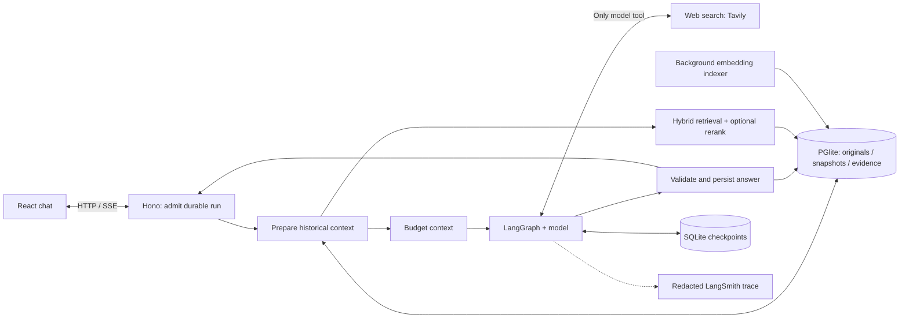

# Threadline — time-aware research agent

“Has Monday’s shortlist changed?” is a temporal-reference problem before it is a search problem. Threadline first recovers the actual discussion, then separates **what we said**, **what sources supported then**, and **what evidence supports now**. An unsupported earlier answer cannot establish a historical price; failure to find an update cannot establish that nothing changed.

## How it works

1. **Admit once.** Persist input, server-controlled owner, fixed time/timezone, historical cutoff, and execution job. An idempotency key prevents duplicate turns. SSE reports progress; reconnect reads durable state. Disconnect does not cancel work; cancellation is explicit, and another input must wait or stop the active run.
2. **Resolve before researching.** Exact date recall queries originals with local-day boundaries and pagination. Other historical references combine lexical and embedding candidates, reciprocal-rank fusion, optional reranking, and hydration of original exchanges. History preparation persists an authorized snapshot, attributes its source conversation, and clarifies competing references. Discussion date and comparison interval are separate. Index lag is reported as incomplete coverage, not missing history.
3. **Fit the question and evidence.** Preserve the current question, historical subjects, and source provenance while compacting older complete exchanges. Every model call reserves output/headroom and checks serialized prompt bytes. This is a bounded proxy, not exact tokenization. Background embeddings use versioned spaces so provider/model changes cannot silently mix incompatible vectors.
4. **Search, then qualify.** The bounded research loop exposes only `web_search`; history and reranking are application operations. Tavily observations retain excerpts, representation, and observation time. Cache hits preserve that time. Structured output supplies claims, evidence IDs, comparison dimensions, and gaps. Publication checks authorized citations, required subjects, and comparison prerequisites; annual/monthly or missing-baseline comparisons cannot become unqualified changes. These checks do not prove semantic support. Research content follows validation; progress streams earlier.
5. **Persist and recover.** PGlite retains messages, snapshots, observations, claims, jobs, and meaningful events; packaged SQLite checkpoints retain graph execution. Recovery reconciles them without assuming a shared transaction. Deadlines and cumulative call/search/attempt/prompt-byte limits survive retries. Incomplete runs can expose labeled source observations awaiting final claim validation; explicit continuation creates a linked run with fresh limits. Recall exclusion and deletion invalidate derived context too.

## Architectural decisions and why they fit

The central decision is a **local modular monolith with explicit ownership of correctness**: one Node application runs transport and bounded workers; model services remain external. History preparation owns reference resolution and provenance, the research workflow owns bounded evidence gathering, and application transactions own admission and final publication. This keeps the assignment runnable locally while preserving boundaries that can evolve independently.

- **Make historical correctness independent of retrieval quality.** A better ranker should help find Monday’s shortlist without changing who may read it, which time window applies, or what counts as an original record. History preparation owns those rules and persists the selected context; the retriever only proposes candidates. SQL handles exhaustive date recall, while embeddings handle paraphrases. This costs extra provenance plumbing but lets retrieval improve behind a stable contract.

- **Validate before publishing research.** A streamed assertion cannot be made reliable merely by attaching a citation afterward. Structured claims let code reject unknown citations, missing subjects, and incompatible price dimensions before publication. Progress streams immediately, but research text waits. That trades early answer tokens for inspectable results; source entailment still needs evaluation rather than another model’s approval.

- **Use a resumable workflow without adding autonomous agents.** The request has one owner, deadline, evidence set, and publication decision. LangGraph/checkpoints support resumption; LangChain handles model messages and tool calls. A separate planner or multi-agent team would add calls and coordination without establishing the right historical baseline. Application transactions still own admission and publication because a graph checkpoint cannot make external database writes atomic.

- **Keep provider choice outside research policy.** The assignment’s value is temporal reasoning and evidence handling, so provider SDK differences should not spread through that logic. OpenAI-compatible clients allow direct endpoints; optional LiteLLM handles heterogeneous routes. Portability has limits: reranking needs a separate contract, fallback models need verified capabilities, and embeddings need isolated generations. Current model routes are tested options, not evidence of a universally best model.

- **Optimize for a reviewer running the product locally.** Node satisfies the assignment; Hono handles its HTTP/SSE needs. PGlite avoids a database service, and the packaged SQLite saver avoids a custom checkpoint adapter. The cost is two stores to reconcile and no demonstrated shared-database concurrency. JSONB vectors and application-side scoring keep local retrieval inspectable; larger histories will require measured indexing work.

- **Treat context and execution as finite resources.** Passing the entire transcript eventually overflows context; replacing it with a summary can lose a product or invent a baseline. Retrieve originals selectively, compact older exchanges, and preserve required subjects. Persisted budgets bound retries; explicit continuation buys more work visibly. Byte-based accounting is an initial approximation that needs model-aware replacement.

- **Separate diagnosis from the answer record.** LangSmith helps explain latency and execution decisions, while durable snapshots and observations explain an answer even if trace export fails. Redaction limits private-content exposure. Traces therefore sacrifice some debugging detail; the local provenance record carries the evidence needed for inspection.

## A worked example

For “Has Monday’s CRM shortlist changed?”, recover the original five products and the 20-person-team requirement before issuing searches. If two discussions fit, clarify which one; otherwise retain the original messages and their attached evidence in the run snapshot. Search current prices and relevant releases for those subjects, then compare matching plan, currency, billing period, and seat assumptions. If Monday’s answer has no supporting observations, the result can report today’s findings but must leave historical change unresolved. Every product receives a finding or explicit gap. A release matters because it affects the team’s needs, not simply because the vendor announced it.

This ordering also controls work: exact recall bypasses model inference, unrelated questions avoid historical retrieval, and resolved subjects focus subsequent search. Background indexing keeps embedding work out of foreground turn execution; reranking is optional. These are latency decisions, not measured speedup claims.

## What the architecture can enforce

Code enforces ownership, eligible-record access, citation registration, structured comparison prerequisites, budgets, and single final publication. Interpretation and research quality remain fallible: reference matching can choose the wrong discussion, the model can misunderstand a passage, and search can miss decisive evidence. Registered citations establish provenance, not truth or exhaustive coverage. Structural validation, ambiguity handling, and human-reviewed evaluations address different parts of that risk.

## Evidence and another week

[Recorded local checks](docs/PHASE12_LOCAL_EVALUATION.md): 157 tests and 3/3 browser scenarios passed. Four synthetic 100-client/10-turn runs measured admission p95 **66–71 ms**, successful completion p95 **6.25–6.54 s**, with one injected failure each; these are not provider latency measurements. The [live batch](docs/PHASE12_LIVE_EVALUATION.md) completed 3/3 scenarios with six model requests/five searches. Missing historical baselines remained unresolved; source coverage was limited and actual billing is unknown.

Another week: prioritize source passages and human-reviewed cases, because correct recall and valid citation IDs can still produce weakly supported conclusions. Reconcile billing and replace byte proxies with model-aware accounting. Move similarity scoring into an index when measured retrieval latency or candidate truncation warrants it. Multiple application processes would require shared persistence and execution fencing; hosted access requires real authentication. Test those boundaries before claiming production readiness.
